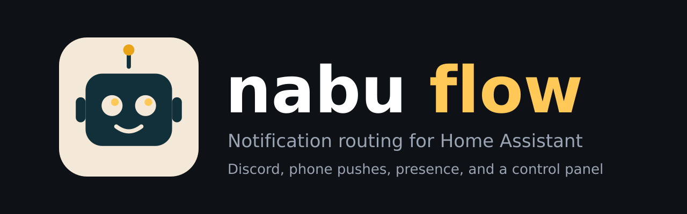

<p align="center">
  
</p>

# Nabu Flow

Notification routing for Home Assistant, with a control panel.

Nabu Flow gives every automation one place to send notifications. You decide, per notification, **who** gets it, whether it goes to **Discord**, whether it hits their **phone** (and how loudly), and whether it should **speak** in the kitchen. It knows who is home, holds the chatter while you sleep, and shows you which of your automations are still notifying the old, noisy way.

Built for a two-person household that wanted Discord for the everyday stuff and loud phone alerts only for what matters.

## Features

- **Routes.** Name a notification once ("Front door open") and save where it goes. Automations call it by name, so changing a path is one edit in the panel instead of fifteen in YAML.
- **Per-person delivery.** Send to one person or everyone. Each person has their own phone, presence entity and optional Discord @mention.
- **Four phone levels.** None, normal, urgent (iOS Time Sensitive) and critical (loud, breaks through silent).
- **Presence aware.** People who are home get a normal banner. People who are away get a silent one, or are skipped entirely. Critical alerts always reach everyone.
- **Discord as the log.** Colored embeds, camera snapshots, @mentions, one channel per topic, and a mirror of every critical alert in a critical log channel.
- **Quiet mode.** One switch moves info-level posts to a digest channel instead of pinging anyone.
- **Cooldowns.** "Same alert at most once every 15 minutes", so a flapping sensor cannot spam you.
- **Kitchen announcements.** Optionally speak the alert on a tablet or display running the companion app, only when someone is home.
- **Audit tab.** Scans your automations and shows which ones notify, and by what path: a Nabu route, a direct phone push, the old script, or something unrouted.
- **History.** The last 100 notifications, what each one did and anything that failed.
- **Backup and restore.** Export or import your whole setup as JSON.

## How it fits together

```
 automation ──> nabu_flow.notify (route: front_door_open)
                    │
                    ├─ route settings (panel) + person presence + quiet mode
                    │
                    ├──> Discord (notify.<your bot>)  ──> #doors, #critical-log
                    ├──> phone push (notify.mobile_app_*) ──> normal / urgent / critical
                    └──> kitchen announce (optional)
```

Nabu Flow does not run a bot itself. It uses Home Assistant's built-in **Discord integration** to post, so there is nothing extra to host and no inbound port to open.

## Requirements

- Home Assistant **2024.7** or newer
- [HACS](https://hacs.xyz)
- The built-in [Discord integration](https://www.home-assistant.io/integrations/discord/) set up with a bot token, if you want Discord posts
- The Home Assistant companion app on phones, if you want pushes

## Install

1. In HACS, open the three-dot menu, choose **Custom repositories**, add `https://github.com/randyjoseph2/Nabu-Flow` with type **Integration**.
2. Search for **Nabu Flow**, download it, and **restart Home Assistant**.
3. Go to **Settings > Devices & services > Add integration**, pick **Nabu Flow**, and confirm.
4. A **Nabu Flow** item appears in the sidebar (admins only).

Manual install: copy `custom_components/nabu_flow` into your config's `custom_components` folder and restart.

## First-time setup

1. **Discord.** In the [Developer Portal](https://discord.com/developers/applications) create an application, add a bot, and copy its token. Under **Installation** enable Guild Install with the `bot` scope and the permissions View Channels, Send Messages, Embed Links and Attach Files, then open the install link to add the bot to your server. In Home Assistant, add the **Discord** integration with that token. The action is named after your application (an app called "Nabu" becomes `notify.nabu`).
2. **Quiet mode switch (optional).** Create a Toggle helper called "Nabu quiet mode". You can flip it manually or automate it around sleep.
3. **People tab.** Add each person: a short key (`randy`), a name, their `person` entity, their phone's `notify.mobile_app_*` service, and optionally their Discord user ID for @mentions.
4. **Channels tab.** Turn on Developer Mode in Discord (User Settings, Advanced), then copy each channel's ID and paste it in. The default channel keys are `doors`, `garage`, `appliances`, `cameras`, `server_and_ha`, `network`, `updates`, `chore_quest`, `groceries`, `reminders`, `digest` and `critical_log`. Rename, add or remove freely.
5. **Settings tab.** Pick the Discord notify service. Use **Send a test** to confirm a post lands.
6. **Routes tab.** Create your first routes.

You can also paste a ready-made setup into **Settings > Backup and restore**. See [`examples/config.example.json`](examples/config.example.json).

## Using it in automations

By route (recommended):

```yaml
actions:
  - action: nabu_flow.notify
    data:
      route: front_door_open
      title: Front door left open
      message: Open for 10 minutes
      camera_entity: camera.front_door
```

The route supplies the channel, recipients, severity and phone level. Anything you add to the call overrides the route for that one notification.

Fully inline, no route:

```yaml
actions:
  - action: nabu_flow.notify
    data:
      who: sam
      channel: reminders
      title: Pick up Parker
      message: Practice ends at 5
      severity: heads_up
      discord: false
      phone: normal
```

More in [`examples/automations.yaml`](examples/automations.yaml).

### Fields

| Field | Values | What it does |
|---|---|---|
| `route` | route id | Use a saved route's settings as defaults |
| `who` | person key, list of keys, or `all` | Recipients for pushes and @mentions |
| `channel` | channel key | Which Discord channel gets it |
| `title`, `message` | text | The notification text |
| `severity` | `info`, `heads_up`, `critical` | Embed color and quiet-mode behavior. Critical also mirrors to the critical log |
| `discord` | `true` / `false` | Turn off for a phone-only notification |
| `phone` | `auto`, `none`, `normal`, `urgent`, `critical` | Push level (see below) |
| `presence` | `aware`, `ignore`, `home_only` | How away people are treated (see below) |
| `announce` | `true` / `false` | Speak it on the announce device if someone is home |
| `camera_entity` | camera entity | Attach a snapshot to the Discord post |
| `link` | URL | Makes the Discord card clickable |
| `dedupe_key`, `cooldown` | text, seconds | Ignore repeats of the same key for that long. Defaults to the route id and the route's cooldown |

### Phone levels

| Level | What the phone does |
|---|---|
| `none` | Nothing |
| `normal` | Regular banner. Respects silent mode and Focus |
| `urgent` | iOS "Time Sensitive". Breaks through Focus, no siren |
| `critical` | Loud. Breaks through silent and Do Not Disturb |
| `auto` | `critical` for critical severity, otherwise `none` |

On iPhone, allow **Critical Alerts** for the Home Assistant app in iOS notification settings, or critical pushes will arrive as normal ones.

### Presence

| Mode | Behavior |
|---|---|
| `aware` (default) | People who are home get a normal banner. People who are away get a silent one. @mentions go to people who are home |
| `home_only` | Skip people who are away. If nobody is home, everyone gets it so nothing is dropped |
| `ignore` | Treat everyone the same |

Critical alerts ignore presence. Everyone always gets them. A person whose presence entity is `unknown` or `unavailable` counts as home.

## The panel

| Tab | What it is for |
|---|---|
| Routes | Create, edit, test and delete routes. Each card shows its path and how many automations use it |
| Audit | Every automation that notifies, and whether it goes through Nabu |
| People | Phones, presence entities, Discord IDs |
| Channels | Discord channel IDs, plus which channels are the default, digest and critical log |
| History | What was sent, to whom, and what failed |
| Settings | Services, quiet-mode entity, test sender, export and import |

The audit reads `automations.yaml` (where the UI saves automations). Blueprint-based automations and automations defined in YAML packages are not scanned yet.

## Dashboard card

A card loads automatically with the integration (no resource to add). It shows the latest notifications, a quiet-mode switch and an optional test button, and works for non-admin users too.

```yaml
type: custom:nabu-flow-card
title: Nabu
limit: 6
test_button: true   # admins only, optional
```

### Top bar card

A header for any dashboard: menu button, logo, title, an Assist (talk to Nabu) button and pill tabs that switch pages.

```yaml
type: custom:nabu-top-bar
title: NewUI 4.0
subtitle: Home Assistant
pages:
  - label: Home
    path: /newui-4-0/home-2-0
  - label: Cameras
    path: /newui-4-0/cameras
```

## Events

Every notification fires a `nabu_flow_sent` event with the same details shown in History, so you can build automations on top of it.

## Limitations

- The Discord integration is send-only. Nabu Flow cannot read messages, add buttons or react to replies.
- Discord posts need a channel ID. A channel without one is skipped and the History tab says so.
- Phone push options such as `time-sensitive` and `critical` are iOS features. Android phones get the notification without those levels.

## Troubleshooting

- **Nothing posts to Discord.** Open History. The failed entry lists the error, usually a missing channel ID or a bot without permission to see that channel.
- **The service `notify.<name>` is not found.** Set the right one in Settings. Check Developer Tools, Actions, and search `notify.`.
- **The panel is blank after an update.** Hard-refresh the browser, or in the companion app clear the frontend cache. The panel files are versioned with `?v=`.
- **Critical pushes are not loud.** See the iOS Critical Alerts note above.
- **Snapshot fails.** The file path must be in an allowed folder. The default, `www/nabu_snapshot.jpg` in your config folder, is allowed automatically.

## Roadmap

- Automation audit for scripts, packages and blueprints
- Scheduled quiet hours and sleep-aware quiet mode
- Escalation: repeat an unacknowledged critical alert, then notify the other person
- Morning digest summary
- Optional Discord bot companion for two-way chat

## Development

Pure-Python logic (routing, config cleaning, audit) is tested without Home Assistant:

```
pip install pytest
pytest
```

The panel is plain JavaScript split into `nabu-flow-kit.js` and `nabu-flow-panel.js`. It avoids template literals and emoji and keeps each file under 24 KB for the iOS companion app. When you release, bump the version in `manifest.json`, `const.py` and the `?v=` import at the top of the panel file.

Publishing steps are in [`docs/PUBLISHING.md`](docs/PUBLISHING.md).

## License

MIT. See [LICENSE](LICENSE).
